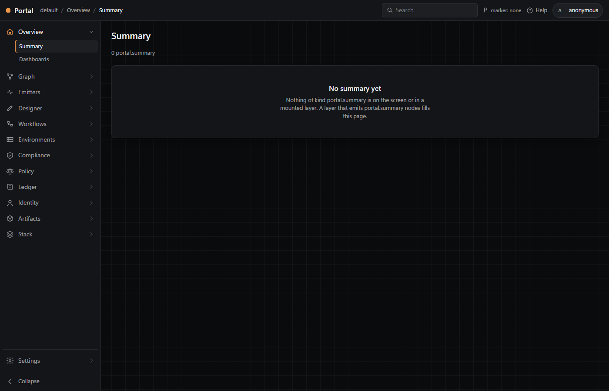

> Terms used here (screen graph, boot, tenant, base config, overlay, menu, Service, Page, principal, role, attenuation, bootstrap, token, tenant mode, dev-bootstrap, service connection, feed, card, content hash, ledger, Container, Widget, Layout, Category, State, Theme, Ref, menu entry, layer, snap, approve) are defined in [ONTOLOGY.md](ONTOLOGY.md).

# Portal

The portal of the graph family: a DevOps-style shell plus one API. A top banner (product, breadcrumb, search, marker, help, avatar), a left rail of services whose pages open in place, and a main pane. The rail is the tenant's menu, served as a Graph.Node envelope built from config (`portal.base.yaml` with the tenant's overlay merged over it); each page lists nodes of its Kind, or draws a screen node (the Canvas on Graph/Explore, the Designer on Designer/Sections), or lists the service connections, the tenant's principals, its tokens or its feeds and the cards pushed to them (docs/design.md 36, 38, 40). Everything a page draws is a node in a Graph.Node envelope. The API reads and changes the screen graph, mounts data layers read-only, approves the screen as a snap and diffs two snaps (docs/design.md 1). Every API path names the tenant, `/api/tenants/<tenant>/...`. A request without a bearer token reads only; writing needs a token the tenant's `tokens.yaml` holds, and the role of the principal it belongs to decides which writes: reader none, contributor all but identity and settings, admin all (docs/design.md 38). A contributor or admin publishes a Graph.Node manifest card to one of the tenant's feeds, an OCI registry or a NuGet feed, and every push is one line of the tenant's ledger (docs/design.md 40). A start boots from the newest approved snap, else from the dev seed (docs/design.md 20). The portal serves on one fixed port, 8200 (docs/design.md 24).

Rows, bottom to top:

```
Graph.Node           the shape: schemas, validators (lifted here at v0.3.0, internal/graphnode)
emitters             write layers: Graph.Emitter.FileSystem, ...
Portal               mounts layers read-only; its own screen and menu are graph/1 envelopes
Graph                orchestrates; calls the PowerShell wrappers here
```

Nothing edits below its own row.



## What is here

| Path | What |
|---|---|
| `api/openapi.yaml` | The one API, OpenAPI 3.0.3. Source of truth for routes, handlers and `web/client.js`. |
| `api/codegen/` | oapi-codegen v2.8.0 config and the `go:generate` directive. |
| `internal/gen/api/` | Generated from the spec: models, chi server interface, embedded spec. Read-only. |
| `internal/server/` | The handlers and the bearer-token and role middleware; Go spec tests (every operation against the spec, route and client parity), the tenant tests (auth, menu, connections, GitHub mocked, shell routes), the identity tests (role matrix, legacy tokens, attenuation, add and revoke on disk), the dev-mode tests (the dev token only in mode dev and from loopback) and the feed tests (push auth, 409, the feeds envelope, the ledger's shape, against fake feeds). |
| `internal/store/` | Screen graph and its boot, validation, layers, snaps and approval, diff, nodes of a Kind across screen and layers. |
| `internal/tenant/` | One tenant: base config plus overlay, merged and validated, and its mode (dev, demo or prod); the menu envelope; identity (principals, roles, tokens, attenuation, dev-bootstrap; the only files the binary writes outside `-artifacts`); service connections and the GitHub call; feeds from the config, the push (one at a time) and the ledger, `ledger.jsonl`, one line appended per push. |
| `internal/feed/` | A card (manifest.yaml checked with the lifted `graph.ValidateManifest`, its files' paths, its content hash) and the push to a feed: an OCI artifact to a registry, a `.nupkg` to a NuGet v3 feed; `feedtest/` holds a fake of each for the tests. |
| `internal/graphnode/` | Graph.Node's schemas (manifest and index included) and `graph` package, lifted at tag v0.3.0, unchanged but for the import path; upstream registers `ui:` to Portal (docs/design.md 4, 34, 40). |
| `cmd/portal/` | The server: `portal [-port 8200] [-artifacts artifacts] [-tenants tenants] [-mount name=path]... [-filesystem <dir or file>] [-no-seed]`, on 127.0.0.1; `-port 0` is refused; `PORTAL_TENANT` names the tenant (default `default`); in a tenant of mode dev, `PORTAL_TOKEN` (when it is a dev-bootstrap token) is what `GET .../dev-token` serves; `PORTAL_SNAP=<stamp>` boots from that snap; `PORTAL_MODE=production` hides the Designer; a feed's `token_env` (`PORTAL_NUGET_KEY` for the base's `cards-nuget`) holds its key, read at push time. A tenant file that fails its check stops it; a token with no principal is named in a warning on stderr. |
| `cmd/graphnode/` | Graph.Node's validator CLI, lifted: `graphnode validate <graph.json> [--ontology <ontology.yaml>]`, `validate-ontology <ontology.yaml>`, `prefixes`, `check-id <prefix> <id>`, `validate-manifest <manifest.yaml>`, `validate-index <index.yaml>`, `index <root>`, `schema [name]`, `version`. |
| `portal.base.yaml` | Product defaults: product name and help link, `theme` (the Canvas's `graph.wheelZoomSpeed`, 1.0), `feeds` (`cards-oci` and `cards-nuget`, the stock services on 127.0.0.1) and the menu tree (services, pages, item tabs). Embedded in the binary; never edited by a tenant. |
| `schema/portal.schema.json` | The one schema for the base and every overlay. |
| `tenants/default/` | The default tenant: `portal.yaml` (an overlay that sets only `mode: dev` for now; never commit it so), `principals.example.yaml`, `tokens.example.yaml` and `connections.example.yaml`. `principals.yaml`, `tokens.yaml`, `connections.yaml`, `ledger.jsonl` and `data/` (the stock services' volumes) are the tenant's own and gitignored. |
| `compose.yaml` | The stock services, project `portal-<tenant>`: `registry:2.8.3` on 127.0.0.1:8201, `bagetter/bagetter:1.6.5` (NuGet v3) on 127.0.0.1:8202, `postgres:16.15-alpine` (database `portal`, not published); volumes under `<tenants>/<tenant>/data/`. `Invoke-Build Feeds` runs it. |
| `web/` | The page: `index.html`, `portal.js` (the shell), `client.js`, `screen.js` (draws screen nodes), page renderers `nodes.js`, `connections.js`, `principals.js` (Identity/Users with an admin's Add, Identity/Agents) `tokens.js` (Settings/Tokens with an admin's Revoke) and `feeds.js` (Artifacts/Feeds, read-only), `icons.js`, Category renderers `canvas.js`, `table.js`, `detail.js`, `designer.js` (with Approve; collapsible sections, each a State node), `toast.js` (refused writes; write controls off, with why, for anonymous or a role that may not), `base.css` (dark), vendored Cytoscape. |
| `ontology.yaml` | Module `Portal` 0.6.0: Kinds Container, Widget, Layout, Category, State, Theme, Ref, Mount, Service, Page, Principal, Feed, Card; edges contains, laid-out-by, is-a, opens, displays, has-page, has-card, has-state, themed-by; findings absent, approved. |
| `src/Portal/` | PowerShell module: `Start-Portal`, `Stop-Portal`, `Get-PortalStatus`, `Get-PortalScreen`, `New-PortalSnap`, `Compare-PortalSnap`, `Mount-PortalLayer`, `New-PortalToken`, `Publish-PortalCard`. |
| `tests/` | Pester (`Invoke-Tests.ps1`, `Portal.Tests.ps1`) and fixtures: `layers/filesystem/` (a FileSystem layer and its ontology), `invalid.graph.json` (Graph.Node's at v0.3.0), `cards/Tool.Git/` (Portal.Tools' `tools/Git` card at c330712, the sample Feeds pushes). |
| `docs/` | `design.md` (decisions, numbered), `manual-check-list.md`, `screenshots/` (`summary.png`, `service-connections.png`, `explore.png`, `identity-users.png`), `prompts/` (task reports). |
| `.claude/skills/` | `manual-check-list`, `ontology-doc`, `readme` (this repo's docs); `graph-node` (0.3.0, copied read-only from Graph.Node v0.3.0); `run-report` 0.2.2 and `git-guard` 0.1.0 (copied read-only from Graph's committed HEAD, 0.2.8). |
| `.claude/settings.json` | Wires `git-guard` as a PreToolUse hook on the Bash and PowerShell tools: an agent's `git commit`, `git push`, `git tag`, `--amend`, `gh pr merge` and `gh release create` are refused. |
| `.env.example` | `PORTAL_PORT=8200`; copy to `.env` (gitignored) to move the portal. `.env` also holds `PORTAL_NUGET_KEY` and `PORTAL_POSTGRES_PASSWORD`, which `Invoke-Build Feeds` writes, random, the first time. |

## Requirements

| Tool | Notes |
|---|---|
| Windows x64 | The only build target. |
| Go 1.27.0+ | `go.mod`; versions pinned there, `go.sum` committed. |
| PowerShell 7.4+ | |
| Pester 5.5+ | `Install-Module Pester -Scope CurrentUser` |
| InvokeBuild | `Install-Module InvokeBuild -Scope CurrentUser` |
| Docker Desktop | `Invoke-Build Feeds` only: `docker compose` v2 and its `--wait`. |
| Edge or Chrome | `Invoke-Build Screenshot`; Chrome for Smoke's rail and Canvas-fit checks and Pester's page checks (each skips without it). |

## Build

```powershell
Invoke-Build              # Modules, Build, Test, Smoke, Pester
Invoke-Build Build        # portal.exe and graphnode.exe into build/win-x64/
Invoke-Build Test         # go vet, go test
Invoke-Build Smoke        # on artifacts/smoke, port 18200, its own tenant and bootstrap admin token: anonymous write refused, seed, menu entry, approve, Theme opacity, approve, restart, rail drawn from the menu, Canvas fits its panel; artifacts/smoke-report.json
Invoke-Build Dev          # only for a tenant in mode dev: mints dev-bootstrap (admin), sets PORTAL_TOKEN, runs Up, prints the token once, DEV ONLY; otherwise refuses
Invoke-Build Feeds        # not in mode prod: compose.yaml up for the tenant (registry, NuGet, Postgres), then Up, then the sample card pushed to cards-oci and cards-nuget and checked in GET .../feeds, the registry and the NuGet feed; a 409 on a rerun is reported
Invoke-Build Up           # portal on http://127.0.0.1:8200 over artifacts/ and tenants/ (-Port, else PORTAL_PORT from .env, else the environment); replaces a running one, -NoReplace throws instead; takes PORTAL_NUGET_KEY from .env when the environment lacks it
Invoke-Build Status       # port, URL and boot stamp
Invoke-Build Down         # stop it
Invoke-Build Generate     # internal/gen from api/openapi.yaml
Invoke-Build Screenshot   # docs/screenshots/summary.png, service-connections.png, explore.png, identity-users.png; mounts Claude.Agent's newest agent-runs layer when present; refuses while tenants/default is mode dev
```

Pester runs only as `pwsh -NoProfile -File .\tests\Invoke-Tests.ps1`.

## Use from PowerShell

The tenant here is a copy of `tenants/default` in a temp directory, so the repo's own `principals.yaml` and `tokens.yaml` are never touched. `New-PortalToken -Bootstrap` makes the tenant's first principal, an admin, and issues its token: it adds the token's hash to `tokens.yaml` and returns the token once. The module sends `PORTAL_TOKEN` as the bearer token.

```powershell
Import-Module .\src\Portal\Portal.psd1
$env:PORTAL_TENANTS = "$env:TEMP\portal-demo-tenants"
New-Item -ItemType Directory -Force "$env:PORTAL_TENANTS\default" | Out-Null
Copy-Item .\tenants\default\portal.yaml "$env:PORTAL_TENANTS\default"
$env:PORTAL_TOKEN = (New-PortalToken -Name demo -Bootstrap).Token
$p = Start-Portal -Port 18200 -Artifacts $env:TEMP\portal-demo -Filesystem .\tests\fixtures\layers\filesystem
$p.Boot                                                             # seed
$p.Tenant                                                           # default
(Get-PortalStatus -Artifacts $env:TEMP\portal-demo).Url             # http://127.0.0.1:18200
$a = New-PortalSnap -Note 'first layout' -Url $p.Url
$auth = @{ Authorization = "Bearer $env:PORTAL_TOKEN" }
Invoke-RestMethod -Method Patch -Uri "$($p.Url)/api/tenants/default/nodes/ui:theme:default" -Headers $auth -ContentType application/json -Body '{"properties":{"opacity":0.2}}' | Out-Null
$b = New-PortalSnap -Note 'lighter glass' -Url $p.Url
$b.diff.changed.nodes                                               # ui:theme:default
(Compare-PortalSnap $a $b -Url $p.Url).changed.nodes.id             # ui:theme:default
(Invoke-RestMethod "$($p.Url)/api/tenants/default/auth/whoami" -Headers $auth).role   # admin
Stop-Portal -Artifacts $env:TEMP\portal-demo
$p = Start-Portal -Port 18200 -Artifacts $env:TEMP\portal-demo -Filesystem .\tests\fixtures\layers\filesystem
$p.Boot -eq $b.stamp                                                # True
(Get-PortalScreen -Url $p.Url).nodes.Count                          # 20
Stop-Portal -Artifacts $env:TEMP\portal-demo
```

### First user

A tenant starts with no principals, and without a token everything reads only. Make the first admin once, then let it add the rest:

1. `New-PortalToken -Name <you> -Bootstrap` writes `tenants/<tenant>/principals.yaml` with you as admin (`createdBy` null) and your token's hash in `tokens.yaml`, and prints the token. A second `-Bootstrap` is an error.
2. Start (or restart) the portal, and give the token in the page's avatar menu, or set `PORTAL_TOKEN` for the module.
3. On Identity/Users, Add a user with a name and a role (reader, contributor or admin; never above your own). The portal appends it to `principals.yaml`, `createdBy` you.
4. `New-PortalToken -Name <user>` issues that user's token. The portal reads it at its next start, or at once after the next Add or Revoke, which re-read the files.
5. Settings/Tokens lists every token by principal, hash prefix and created; an admin's Revoke removes one at once.

A `tokens.yaml` from before 0.5.0 keeps working: an entry with `name` and no `principal` acts as admin until revoked, and the portal names it in a warning at boot. It cannot add users; bootstrap a principal first.

### Dev mode

Nobody pastes tokens during development. A tenant's `portal.yaml` says what it is run for: `mode: dev`, `demo` or `prod` (prod when absent). The banner shows the mode; in dev an amber bar under it reads `DEV MODE — auto-minted admin, local sign-in shortcut. Not for demo or production. See README: Before you demo.`, and in demo a thin blue bar reads `DEMO`. Neither can be dismissed.

`Invoke-Build Dev` runs only for a tenant in mode dev; for any other it says why and stops, minting nothing. It makes the principal `dev-bootstrap` (an admin) in the tenant's gitignored `principals.yaml` when it is not there, replaces every earlier `dev-bootstrap` token in `tokens.yaml` with a new one, sets `PORTAL_TOKEN` to it, runs `Up`, and prints the token once, labelled DEV ONLY. In the page, the avatar's box has `Use dev token`, which reads that token from `GET /api/tenants/<tenant>/dev-token`. That route answers only in mode dev, to 127.0.0.1, on a portal `Invoke-Build Dev` started; anywhere else it is 404. `Invoke-Build Up` never mints anything. Outside mode dev, `dev-bootstrap`'s tokens are refused (401) and the boot warns while any is left (docs/design.md 39).

### Before you demo

A dev-mode portal is never shown to anyone. Before a demo, a screenshot or a recording:

1. Mint a real admin with `New-PortalToken -Name <you> -Bootstrap`. It is made beside `dev-bootstrap`; if the tenant already has its first admin, `-Bootstrap` refuses, so use `New-PortalToken -Name <you>`.
2. Sign in as that admin (avatar, paste the token) and revoke `dev-bootstrap`'s token under Settings → Tokens.
3. Switch the tenant's mode to demo: `mode: demo` in `tenants/<tenant>/portal.yaml`, then restart with `Invoke-Build Up` (`Dev` refuses now).
4. Confirm the amber bar is gone: the bar reads `DEMO`, and the avatar's box has no `Use dev token`.
5. Confirm the avatar shows the real name and role, `<you> · admin`, not `dev-bootstrap`.

The order differs from switching first: once the tenant is in demo, `dev-bootstrap` can no longer sign in, so the revoke needs the real admin. Pester fails while `tenants/default/portal.yaml` is committed or staged with mode dev, and `Invoke-Build Screenshot` refuses while it is.

### Publishing a card

A card is a folder holding a Graph.Node `manifest.yaml` (`name`, `version`, `type`, `description`, and optionally `tags`, `needs`, `verbs`, `pins`; Graph.Node design 21) and whatever else the thing needs, such as Portal.Tools' `install.yaml`. A feed is one entry of the config's `feeds:`. The base has two, the stock services of `compose.yaml`: `cards-oci`, an OCI registry, and `cards-nuget`, a NuGet v3 feed. A tenant's `portal.yaml` overrides one by `id` or adds its own:

```yaml
feeds:
  - { id: cards-oci, url: "http://127.0.0.1:8201/team" }
  - { id: team-nuget, kind: nuget, url: "https://nuget.example/v3/index.json", token_env: TEAM_NUGET_KEY }
```

`Invoke-Build Feeds` (Docker Desktop; any mode but prod) starts the stock services for the tenant, restarts the portal holding the NuGet key, and pushes `tests/fixtures/cards/Tool.Git` to both feeds. After that, any card goes through the API with a contributor's or admin's token:

```powershell
$env:PORTAL_TOKEN = '<a contributor or admin token>'
$e = Publish-PortalCard -Feed cards-oci -Path ..\Portal.Tools\tools\Terraform
$e.result, $e.card, $e.version, $e.hash                             # pushed Tool.Terraform 0.1.0 sha256:...
Publish-PortalCard -Feed cards-oci -Path ..\Portal.Tools\tools\Terraform   # throws: -> 409 ... already in cards-oci
```

- The portal checks `manifest.yaml` with Graph.Node 0.3.0's manifest schema. A card that fails is 422 with Graph.Node's `schema` problems, at paths `manifest.yaml:/...`.
- It sends the card on as an OCI artifact (`cards/tool.terraform:0.1.0`, one layer per file, so `oras pull` gives back the folder) or as a `.nupkg` (id `Tool.Terraform`, the card's files at the package root).
- A name and version the ledger or the feed already holds is 409.
- Every push that names a feed the tenant has is one line of `tenants/<tenant>/ledger.jsonl`, whatever its result: who, which feed, the card's name and version, its content hash, the feed's digest, and `pushed`, `duplicate`, `invalid` or `failed`.
- Artifacts/Feeds lists each feed and the cards in it, with version and hash. Read-only: nothing on the page pushes (docs/design.md 40).

`Start-Portal -Snap <stamp>` boots from an older snap instead of the newest. `-Tenant` (else `PORTAL_TENANT`, else `default`) and `-Tenants` (else `PORTAL_TENANTS`, else the repo's `tenants/`) say which tenant it serves. Without `-Port` it serves on 8200, or `PORTAL_PORT` from `.env` or the environment; a busy port throws naming its owner. On the page, the avatar menu takes a token for the browser tab.

## Use the API

Every path below starts `/api/tenants/{tenant}`. The process serves one tenant; any other is 404. Writes, and `/connections/{name}/repos`, which spends the tenant's GitHub token, need `Authorization: Bearer <token>` (401 without it); a token the tenant does not hold is 401 on any request. A write the principal's role does not allow is 403: a reader writes nothing (a push included), a contributor no identity (`POST /principals`, `DELETE /tokens/{id}`), and no one creates a principal above its own role.

```
GET    /api/tenants/{tenant} itself         {name, mode}: the tenant and its mode, dev, demo or prod
GET    /dev-token                           {token, principal, role} of dev-bootstrap: mode dev, from 127.0.0.1, on a portal Invoke-Build Dev started; else 404
GET    /config                              the merged config: portal.base.yaml with the tenant's portal.yaml over it
GET    /menu                                the rail as an envelope: Service and Page nodes, has-page, icon States
GET    /auth/whoami                         {id, name, type, role, anonymous, legacy, writes, administers, tenant, marker}
GET    /principals     POST /principals     Principal nodes; add a user {name, role}: admin only, role at most yours (403)
GET    /tokens                              {id (hash prefix), principal, name, created, legacy} per token, never a token
DELETE /tokens/{id}                         revoke: removed from tokens.yaml, refused from then on; admin only
GET    /connections                         service connections, no secrets: name, type, url, token_env, tokenSet, createdBy
GET    /connections/{name}/repos            github: the token's repositories as git.repository nodes; needs a bearer token (401); 422 no GitHub token, 502 GitHub refused
GET    /feeds                               Feed nodes (the merged config's feeds) and the Card nodes pushed to each, has-card
POST   /feeds/{feed}/push                   multipart: manifest (manifest.yaml) and file parts (filename = path in the card's folder); contributor or admin; 201 the ledger line; 409 duplicate; 422 Graph.Node problems; 502 the feed failed
GET    /nodes?kind=                         every node of a Kind on the screen and in the mounted layers
GET    /screen                              the screen graph (envelope); header X-Portal-Boot: <stamp>, seed or empty
POST   /nodes          POST /edges          add; Graph.Node shape; validated before accept
PATCH  /nodes/{id}                          properties and display State only
DELETE /nodes/{id}                          the node and its edges
GET    /layers         POST /layers         mounted layers; mount from a path (recorded as ui:mount:<name>) or an envelope
GET    /layers/{name}/nodes?kind=&from=     query a layer
POST   /snap           {"note": "..."}      approve: artifacts/snaps/<stamp>.graph.json, previous, diff summary
GET    /diff?a=<stamp>&b=<stamp>            added, removed, changed, and the merge
GET    /ontology                            portal ontology and every layer's
```

`POST /api/layers`, without the tenant, is kept (deprecated) as the mount for this process's tenant, so Claude.Agent's Up still finds it; it needs a token like any write. The page's routes are `/<tenant>/<service>/<page>[/<id>]`; `/` redirects to the first page. A refused write answers 422 with `problems`, each `{code, path, message, severity}`; the codes are listed in [ONTOLOGY.md](ONTOLOGY.md).

## Status

0.6.0: feeds. `compose.yaml` with a pinned OCI registry, NuGet feed (BaGetter) and Postgres 16, published on 127.0.0.1 only, data under the tenant; `feeds:` in the config, overridable per tenant; Kinds `Feed` and `Card` served by `GET .../feeds` and drawn read-only on Artifacts/Feeds; `POST .../feeds/{feed}/push`, checked with Graph.Node 0.3.0's manifest schema (lift and `graph-node` at v0.3.0), contributor or admin, 409 on a duplicate, one line per push in `tenants/<tenant>/ledger.jsonl`; `Publish-PortalCard`; `Invoke-Build Feeds`, refused in mode prod (docs/design.md 40). 0.5.1: dev mode. A tenant's `mode` (dev, demo or prod) on `GET /api/tenants/<tenant>` and in the banner; `Invoke-Build Dev` mints the admin `dev-bootstrap` for a tenant in mode dev and starts the portal with its token; the avatar's box offers `Use dev token` from `GET .../dev-token` (mode dev, loopback only); an amber DEV MODE bar, a blue DEMO bar; `dev-bootstrap` refused outside mode dev; Before you demo (docs/design.md 39). 0.5.0: identity. Principals (Kind `Principal`: user or agent, role reader, contributor or admin, `createdBy`) in `principals.yaml`; tokens belong to a principal; roles enforced (403), with attenuation; `New-PortalToken -Bootstrap`; Identity/Users with Add and Settings/Tokens with Revoke; service connections record `createdBy` (docs/design.md 38). 0.4.1: read-only page for an anonymous viewer (write controls disabled, refused writes as toasts) and the config's `theme.graph.wheelZoomSpeed` (docs/design.md 37). 0.4.0: the DevOps-style shell (banner, rail from the tenant's menu, main pane), dark theme, base and tenant config split, tenant in every API path, bearer-token writes, service connections with a first GitHub type (docs/design.md 36). 0.3.6: the Graph.Node lift and `graph-node` skill at v0.2.3; the dev seed has the Runs menu entry and its `agent-runs` Canvas. 0.3.5: a layer mounted by path is a Mount node on screen (`ui:mount:<name>`), so an approved snap mounts it again at boot. 0.3.4: `Invoke-Build Up` replaces a running portal. 0.3.3: `graph-node` and the lift at v0.2.1. 0.3.2: the `git-guard` hook, `run-report` 0.2.2. 0.3.1: Designer sections collapsible, each a State node; the Canvas fits its panel after load. Decisions and what was deferred: docs/design.md (40 is 0.6.0's, 39 0.5.1's, 38 0.5.0's, 37 0.4.1's, 36 0.4.0's, 34 and 35 0.3.6's, 33 0.3.5's, 32 0.3.4's, 31 0.3.3's, 30 0.3.2's, 28 and 29 0.3.1's, 24 to 27 0.3.0's, 18 to 23 0.2.0's; 9, 15, 16, 22, 36, 38 and 40 name the next questions).
