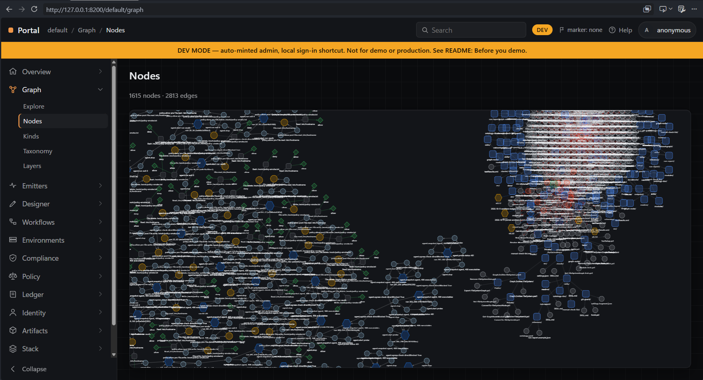
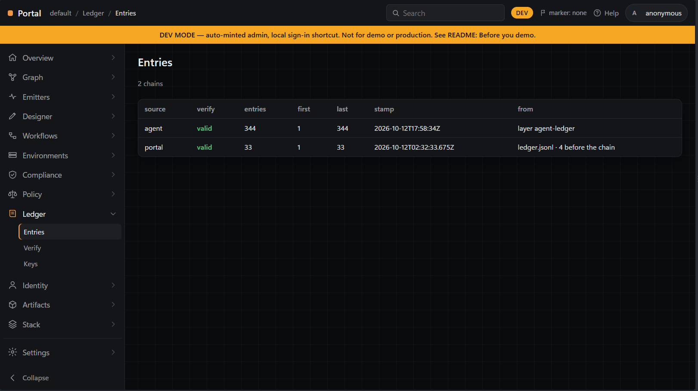
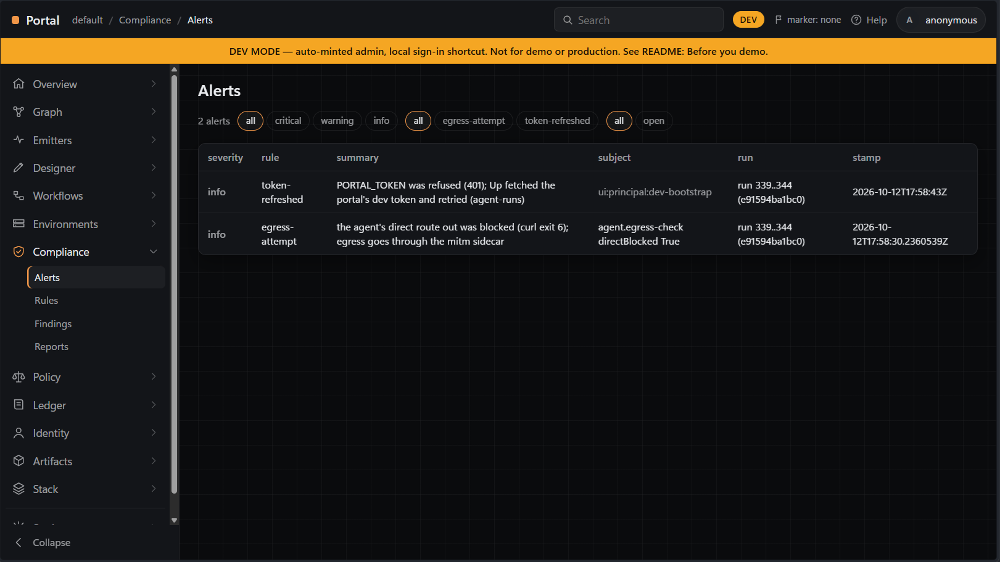

<p align="center">
  
</p>

<p align="center">
  
  
  
  
</p>

<p align="center">
  <sub><a href="https://github.com/kyechan99/capsule-render">Above was created by capsule-render</a></sub>
</p>

# Portal

> Terms used here (screen graph, boot, tenant, base config, overlay, menu, Service, Page, principal, role, attenuation, bootstrap, token, tenant mode, dev-bootstrap, service connection, agent, Run, Decision, feed, card, content hash, ledger, ledger chain, verify, LedgerEntry, environments graph, node menu, alert, alert layer, alerts badge, action, action request, action result, Runner, Container, Widget, Layout, Category, State, Theme, Ref, menu entry, layer, snap, approve) are defined in [ONTOLOGY.md](ONTOLOGY.md).

Portal is a local DevOps-style control plane for AI agents. Every agent run, decision and action is a node in a graph, recorded in a hash-chained ledger, and checked against an ontology so the agent can only do what the tenant's vocabulary allows. The point is accountability: you can see what the agent did, prove the record wasn't altered, and get an alert when it tried something it shouldn't. Built in Go with a PowerShell module on top.

The portal of the graph family: a DevOps-style shell plus one API. A top banner (product, breadcrumb, search, marker, help, avatar), a left rail of services whose pages open in place, and a main pane. The rail is the tenant's menu, served as a Graph.Node envelope built from config (`portal.base.yaml` with the tenant's overlay merged over it); each page lists nodes of its Kind, or draws a screen node (the Canvas on Graph/Explore, the Designer on Designer/Sections), or lists the service connections, the tenant's principals, its tokens, its feeds and the cards pushed to them, or the mounted layers, each with its own page, or the agents and their runs, or the emitters and the layers each produced, or the ledger chains, or the environments graph, whose nodes open a right-click menu, or the alerts an alert layer raises, their open count in a badge beside the mode, or the action requests asked of containers and the Runner's results (docs/design.md 36, 38, 40, 42, 43, 44, 45, 46, 47, 50). Everything a page draws is a node in a Graph.Node envelope. The API reads and changes the screen graph, mounts data layers read-only, approves the screen as a snap and diffs two snaps (docs/design.md 1). Every API path names the tenant, `/api/tenants/<tenant>/...`. A request without a bearer token reads only; writing needs a token the tenant's `tokens.yaml` holds, and the role of the principal it belongs to decides which writes: reader none, contributor all but identity and settings, admin all (docs/design.md 38). A contributor or admin publishes a Graph.Node manifest card to one of the tenant's feeds, an OCI registry or a NuGet feed, and every push is one line of the tenant's ledger (docs/design.md 40). A contributor or admin asks for an action on a container (logs, stop, restart) from the environments graph's right-click menu; the ask is one more line of that ledger, as the signed-in principal, and Portal.Agent's Runner, not Portal, runs it and records the result in the agent's ledger (docs/design.md 50). A start boots from the newest approved snap, else from the dev seed (docs/design.md 20). The portal serves on one fixed port, 8200 (docs/design.md 24).

Rows, bottom to top:

```
Graph.Node           the shape: schemas, validators (lifted here at v0.4.2, internal/graphnode)
emitters             write layers: Graph.Emitter.FileSystem, ...
Portal               mounts layers read-only; its own screen and menu are graph/1 envelopes
Graph                orchestrates; calls the PowerShell wrappers here
```

Nothing edits below its own row.



*Graph → Nodes: the whole tenant graph, 1615 nodes and 2813 edges, agent run layers on the left and the Portal repos on the right.*



*Ledger → Entries: two chains, both valid: the agent's 344 entries from the agent-ledger layer and Portal's 33 from ledger.jsonl.*



*Compliance → Alerts: two info alerts from agent run 339..344, a refused PORTAL_TOKEN retried and a blocked direct egress attempt.*

## What is here

| Path | What |
|---|---|
| `api/openapi.yaml` | The one API, OpenAPI 3.0.3. Source of truth for routes, handlers and `web/client.js`. |
| `api/codegen/` | oapi-codegen v2.8.0 config and the `go:generate` directive. |
| `internal/gen/api/` | Generated from the spec: models, chi server interface, embedded spec. Read-only. |
| `internal/server/` | The handlers and the bearer-token and role middleware; Go spec tests (every operation against the spec, route and client parity), the tenant tests (auth, menu, connections, GitHub mocked, shell routes), the identity tests (role matrix, legacy tokens, attenuation, add and revoke on disk), the dev-mode tests (the dev token only in mode dev and from loopback), the agents tests (runs grouped by the mounting principal, counts, newest first, shared ids, after a restart), the emitters tests (the nine Graph.Node 0.4.0 cards pushing with module, repo, url and emits; a layer matched by its source block, each status: ok, version-mismatch, no-layers, no-card, unstamped; each emitter's nodes; no name mapped onto another; 404 for a name that is no emitter; the boot check of an emitter card named like a page), the ledger tests (the good and the broken fixture chain, every records edge resolving to the runs layer, paging and the run filter, Portal's own chain over an unchained head and a hand edit), the environments tests (the real environment layer and its tagged copy: environment nodes, one-hop neighbours, edge kinds, has-run, first layer wins), the actions tests (the ask's validation, the principal from the token and never the body, the line on disk, the join of requests to the ledger layer's results, an alert layer's copy answering nothing, the menu's containers being the API's, a bad request line stopping the boot), the tenant graph tests (every mounted node and edge, `?source=` matching a layer's source block exactly, edges pruned to the kept nodes, no match empty), the query tests (a chain walked to depth 1, 2 and 3, `until`, `direction=in` and `both`, `where`, two starts, `kind`, the `limit` truncation flag, `source`, the 400s naming an unknown id, empty as 200; the tenant graph as the query at depth 0), the alerts tests (the alert fixture: order, open counts, each subject and run as Portal serves it, the filters and pages, a re-emit winning, the alert layer's copies never the ledger nor an environment, a run's alerts count) and the feed tests (push auth, 409, the feeds envelope, the ledger's shape, against fake feeds). |
| `internal/store/` | Screen graph and its boot, validation, layers (and who mounted each), snaps and approval, diff, nodes of a Kind across screen and layers, the tenant graph (every node and edge of the mounted layers, or of the layers whose source block names one emitter) and the query over it (`query.go`: one breadth-first walk from start ids or a Kind, along edge kinds, in a direction, to a depth, through two calls, `Neighbours` and `NodesOfKind`, that an adapter can implement), the runs of every mounted Graph.Emitter.Agent layer, the emitter each layer's ontology names, the agent's ledger chain from a mounted ledger layer and the verify of any chain, the environments graph (every `environment.*` node of the mounted layers and the edges one hop out), the alerts of the mounted alert layers (whose other nodes are copies, never read as the ledger or as environments), and the Runner's action results read from the ledger layer. |
| `internal/tenant/` | One tenant: base config plus overlay, merged and validated, and its mode (dev, demo or prod); the menu envelope; identity (principals, roles, tokens, attenuation, dev-bootstrap; the only files the binary writes outside `-artifacts`); service connections and the GitHub call; feeds from the config, the push (one at a time) and the ledger, `ledger.jsonl`, one line appended per push or per action request, each chained to the line before by `seq` and `prev`, one ledger the Runner appends its action results to as well, its tail read again under the file's lock before each append and before each read; action requests (`actions.go`: the three actions, a container subject, the principal from the token); the ledger sources, and the boot refusal of a ledger page named like one; emitter names, and the boot check of emitter cards against the Emitters service's pages; the Environments page `graph`, which the boot refuses with any view but `environments-graph`; the Compliance page `alerts`, which it refuses with any view but `alerts`. |
| `internal/feed/` | A card (manifest.yaml checked with the lifted `graph.ValidateManifest`, its files' paths, its content hash) and the push to a feed: an OCI artifact to a registry, a `.nupkg` to a NuGet v3 feed; `feedtest/` holds a fake of each for the tests. |
| `internal/graphnode/` | Graph.Node's schemas (manifest and index included) and `graph` package, lifted at tag v0.4.2, unchanged but for the import path; upstream registers `ui:` to Portal and, since v0.3.2, `env:` to Claude.Agent.Orchestrator with `alert:<fingerprint>` accepted; since v0.4.0 an emitter card needs `module`, `repo` and `emits` (docs/design.md 4, 34, 40, 48, 49). |
| `cmd/portal/` | The server: `portal [-port 8200] [-artifacts artifacts] [-tenants tenants] [-mount name=path]... [-filesystem <dir or file>] [-no-seed]`, on 127.0.0.1; `-port 0` is refused; `PORTAL_TENANT` names the tenant (default `default`); in a tenant of mode dev, `PORTAL_TOKEN` (when it is a dev-bootstrap token) is what `GET .../dev-token` serves; `PORTAL_SNAP=<stamp>` boots from that snap; `PORTAL_MODE=production` hides the Designer; a feed's `token_env` (`PORTAL_NUGET_KEY` for the base's `cards-nuget`) holds its key, read at push time. A tenant file that fails its check stops it; a token with no principal is named in a warning on stderr. |
| `cmd/graphnode/` | Graph.Node's validator CLI, lifted: `graphnode validate <graph.json> [--ontology <ontology.yaml>]`, `validate-ontology <ontology.yaml>`, `prefixes`, `check-id <prefix> <id>`, `validate-manifest <manifest.yaml>`, `validate-index <index.yaml>`, `index <root>`, `schema [name]`, `version`. |
| `portal.base.yaml` | Product defaults: product name and help link, `theme` (`graph.wheelZoomSpeed`, 1.0: every graph page's mouse-wheel zoom speed and the default of its Wheel control; [docs/tenant-ui-settings.md](docs/tenant-ui-settings.md)), `feeds` (`cards-oci` and `cards-nuget`, the stock services on 127.0.0.1) and the menu tree (services, pages, item tabs). Embedded in the binary; never edited by a tenant. |
| `schema/portal.schema.json` | The one schema for the base and every overlay. |
| `tenants/default/` | The default tenant: `portal.yaml` (an overlay that sets only `mode: dev` for now; never commit it so), `principals.example.yaml`, `tokens.example.yaml` and `connections.example.yaml`. `principals.yaml`, `tokens.yaml`, `connections.yaml`, `ledger.jsonl` and `data/` (the stock services' volumes) are the tenant's own and gitignored. |
| `compose.yaml` | The stock services, project `portal-<tenant>`: `registry:2.8.3` on 127.0.0.1:8201, `bagetter/bagetter:1.6.5` (NuGet v3) on 127.0.0.1:8202, `postgres:16.15-alpine` (database `portal`, not published); volumes under `<tenants>/<tenant>/data/`. `Invoke-Build Feeds` runs it. |
| `web/` | The page: `index.html`, `portal.js` (the shell), `client.js`, `screen.js` (draws screen nodes), page renderers `nodes.js`, `connections.js`, `principals.js` (Identity/Users with an admin's Add), `agents.js` (Identity/Agents at `/<tenant>/agents` and each agent's runs), `emitters.js` (Emitters/Catalogue at `/<tenant>/emitters`, its nodes column and row menu, and each emitter's layers with Show graph), `graph.js` (Graph/Nodes at `/<tenant>/graph`: the tenant graph in Cytoscape, `?source=<emitter>` as a chip that clears it), `query.js` (Graph/Explore's query bar, its fields the URL, the result drawn with `graph.js` and its paths listed under it), `ledger.js` (Ledger/Entries at `/<tenant>/ledger`, each chain's entries and one entry), `envgraph.js` (Environments/Graph: the environments graph in SVG, the selected node after `#`), `nodemenu.js` (the right-click node menu on the graph, on environment rows and, with its own items, on alert rows and Catalogue rows; Query from here, alone, on any Cytoscape node), `alerts.js` (Compliance/Alerts, each alert's page, the banner's badge and the subject pages' alerts rows), `actions.js` (Environments/Actions at `/<tenant>/actions`, and the node menu's ask with its confirm), `tokens.js` (Settings/Tokens with an admin's Revoke), `feeds.js` (Artifacts/Feeds, read-only) and `layers.js` (Graph/Layers and each layer's page, with its produced-by line), `icons.js`, Category renderers `canvas.js`, `table.js`, `detail.js`, `designer.js` (with Approve; collapsible sections, each a State node), `toast.js` (refused writes; write controls off, with why, for anonymous or a role that may not), `wheel-speed.js` (every graph page's wheel zoom speed: the config's default, the toolbar's Wheel control, a per-page override in the browser's localStorage), `base.css` (dark), vendored Cytoscape. |
| `ontology.yaml` | Module `Portal` 0.16.5: Kinds Container, Widget, Layout, Category, State, Theme, Ref, Mount, Service, Page, Principal, Feed, Card, Emitter, Layer, Run, Decision, Ledger, LedgerEntry, Alerts, Alert, Actions; edges contains, laid-out-by, is-a, opens, displays, has-page, has-card, produced-by, has-layer, has-run, has-decision, has-entry, prev, records, recorded-in, has-action, answered-by, answers, request, subject, principal, has-alert, about, raised-in, has-state, themed-by; findings absent, approved. |
| `src/Portal/` | PowerShell module: `Start-Portal`, `Stop-Portal`, `Get-PortalStatus`, `Get-PortalScreen`, `New-PortalSnap`, `Compare-PortalSnap`, `Mount-PortalLayer`, `New-PortalToken`, `Publish-PortalCard`. |
| `tests/` | Pester (`Invoke-Tests.ps1`, `Portal.Tests.ps1`) and fixtures: `layers/filesystem/` (a FileSystem layer and its ontology), `layers/agent-runs/` (a Graph.Emitter.Agent runs layer and its ontology, Portal.Emitters' `emitters/Agent/artifacts/layers` at cd862d9: one run, three steps, four allow, one deny), `layers/ledger/` (an agent ledger layer built to Portal.Agent's shape: seq 44 to 55, a valid chain whose records edges name that run and its steps), `ledger/actions.ledger.jsonl` (a tenant ledger, one chain: three action requests, then the Runner's results answering two of them, done and failed; the third the gap) and `layers/ledger-broken/` (seq 44 to 55 with entry 50 altered, broken at 51), `layers/agent-environment/` (Portal.Agent's environment layer from Up on 2026-10-11 19:00, byte for byte: a compose stack, its three containers, three images and two networks, all under `env:` ids) and `layers/agent-environment-tagged/` (the same with group and tags on three instances, no env on the ledger keeper, its hosts edge onto the agent-runs run), `layers/agent-alerts/` (Portal.Agent's alert layer from the same Up, byte for byte: one info alert under `alert:<fingerprint>` about `ledger:303`; the tests mount five varied alerts inline beside it), `invalid.graph.json` (Graph.Node's at v0.3.3), `cards/Tool.Git/` (Portal.Tools' `tools/Git` card at c330712, the sample Feeds pushes), `cards/Emitter.<X>/` (the nine emitter cards of Portal.Emitters v0.2.0, `emitters/<folder>/manifest.yaml` byte for byte, Graph.Node 0.4.0 manifests: Agent, AzureDevOps, Environment, FileSystem, Git, Ledger, Network, Reference, Terraform; the tests stamp copies of the real layers with a source block naming them, docs/design.md 49). |
| `scripts/` | `Refresh-Portal.ps1`: `Invoke-Build Refresh` from any directory. |
| `docs/` | `design.md` (decisions, numbered), `refresh/` (`dependency-order.md`, the Refresh order across the Portal repos and its conflicts; `order.psd1`, the same as data), `api/query.md` (the tenant graph query: every parameter, worked examples), `api/actions.md` (the actions ledger contract and its ids, which Portal.Agent's Runner follows), `tenant-ui-settings.md` (the tenant's UI settings and the browser's per-page overrides), `manual-check-list.md`, `screenshots/` (`summary.png`, `service-connections.png`, `explore.png`, `identity-users.png` from `Invoke-Build Screenshot`; `nodes.png`, `ledger.png`, `alerts.png` captured by hand, shown above), `prompts/` (task reports). |
| `.claude/skills/` | `manual-check-list`, `ontology-doc`, `readme` (this repo's docs); `graph-node` (0.4.2, copied read-only from Graph.Node v0.4.2); `run-report` 0.2.2 and `git-guard` 0.1.0 (copied read-only from Graph's committed HEAD, 0.2.8). |
| `.claude/settings.json` | Wires `git-guard` as a PreToolUse hook on the Bash and PowerShell tools: an agent's `git commit`, `git push`, `git tag`, `--amend`, `gh pr merge` and `gh release create` are refused. |
| `.env.example` | `PORTAL_PORT=8200`; copy to `.env` (gitignored) to move the portal. `.env` also holds `PORTAL_NUGET_KEY` and `PORTAL_POSTGRES_PASSWORD`, which `Invoke-Build Feeds` writes, random, the first time. |

## Requirements

| Tool | Notes |
|---|---|
| Windows x64 | The only build target. |
| Go 1.27.0+ | `go.mod`; versions pinned there, `go.sum` committed. |
| PowerShell 7.4+ | |
| Pester 5.5+ | `Install-Module Pester -Scope CurrentUser` |
| InvokeBuild | `Install-Module InvokeBuild -Scope CurrentUser` |
| Docker Desktop | `Invoke-Build Feeds` only: `docker compose` v2 and its `--wait`. |
| Edge or Chrome | `Invoke-Build Screenshot`; Chrome for Smoke's rail, Canvas-fit and wheel-speed checks and Pester's page checks (each skips without it). |

## Build

```powershell
Invoke-Build              # Modules, Build, Test, Smoke, Pester
Invoke-Build Build        # portal.exe and graphnode.exe into build/win-x64/
Invoke-Build Test         # go vet, go test
Invoke-Build Smoke        # on artifacts/smoke, port 18200, its own tenant and bootstrap admin token: anonymous write refused, seed, menu entry, approve, Theme opacity, approve, restart, rail drawn from the menu, Canvas fits its panel, every graph page loads its Wheel control at the config's speed; artifacts/smoke-report.json
Invoke-Build Dev          # only for a tenant in mode dev: mints dev-bootstrap (admin), sets PORTAL_TOKEN, runs Up, prints the token once, DEV ONLY; otherwise refuses
Invoke-Build Feeds        # not in mode prod: compose.yaml up for the tenant (registry, NuGet, Postgres), then Up, then the sample card pushed to cards-oci and cards-nuget and checked in GET .../feeds, the registry and the NuGet feed; a 409 on a rerun is reported
Invoke-Build Up           # portal on http://127.0.0.1:8200 over artifacts/ and tenants/ (-Port, else PORTAL_PORT from .env, else the environment); replaces a running one, -NoReplace throws instead; takes PORTAL_NUGET_KEY from .env when the environment lacks it
Invoke-Build Status       # port, URL and boot stamp; "unrecorded" for a portal serving artifacts/ whose portal.json is gone
Invoke-Build Down         # stop every portal serving artifacts/, recorded or not; throws, keeping the record, if one survives
Invoke-Build Generate     # internal/gen from api/openapi.yaml
Invoke-Build Screenshot   # docs/screenshots/summary.png, service-connections.png, explore.png, identity-users.png (not nodes.png, ledger.png, alerts.png: hand captures); mounts Claude.Agent's newest agent-runs layer when present; refuses while tenants/default is mode dev
Invoke-Build Refresh      # every Portal repo down and back up in docs/refresh/order.psd1's order, a snap approved, the Catalogue checked; -DryRun prints the plan
```

Pester runs only as `pwsh -NoProfile -File .\tests\Invoke-Tests.ps1`.

### Refresh: run this after any change in any repo

```powershell
Invoke-Build Refresh -DryRun                                       # the plan: what each step would run or skip, nothing run
Invoke-Build Refresh                                               # in this repo
pwsh -NoProfile -File C:\__Code\Portal\scripts\Refresh-Portal.ps1  # the same, from any directory
```

Refresh takes everything down and brings it back up in the order [docs/refresh/dependency-order.md](docs/refresh/dependency-order.md) derives from the repos themselves. [docs/refresh/order.psd1](docs/refresh/order.psd1) holds the same order as data, and Refresh reads only that file. Before it runs anything, it checks the order against rules R1 to R6. The steps are:

1. Portal.Agent `Down` (skipped when the Docker engine is not answering).
2. Portal `Down`, then `Dev`, so the tenant must be in mode dev. `Down` fails, naming the holder, when the port `Up` uses is still held after it.
3. Portal.Emitters `Mount`, which restarts Portal twice. It runs before any live layer is pushed.
4. Portal.Agent `Up`, which pushes its four layers.
5. One approved snap, which saves those layers.
6. `GET .../emitters`, the Catalogue table.

Refresh prints one line per step, and the same lines go to `artifacts/refresh/<stamp>/refresh.log`. An invoke step's own output goes to `artifacts/refresh/<stamp>/<n>-<id>.log`, and while it runs its line shows the elapsed seconds every 15 s. Every step that calls the API fetches the dev token from `GET .../dev-token` immediately before its call, because every Portal start mints a new one. Its line names the token's first 8 characters. It never sends `PORTAL_TOKEN`. A portal started with `Up` serves no dev token, so Refresh fails there, naming it (docs/design.md 59). A repo not on disk is skipped and said so, and so are the card-only repos (Ontology, Skills, Tools, Workflows), which have nothing to run. Refresh fails, naming the card, when a card that read `ok` in the last Refresh now reads `no-layers` or `version-mismatch`. The last passing roll call is `artifacts/refresh/last.json`, and a failing one is `failed.json`. `Invoke-Build Feeds` is not part of Refresh. Run it first when the stock feeds are wanted (docs/design.md 56).

## Use from PowerShell

The tenant here is a copy of `tenants/default` in a temp directory, so the repo's own `principals.yaml` and `tokens.yaml` are never touched. `New-PortalToken -Bootstrap` makes the tenant's first principal, an admin, and issues its token: it adds the token's hash to `tokens.yaml` and returns the token once. The module sends `PORTAL_TOKEN` as the bearer token.

```powershell
Import-Module .\src\Portal\Portal.psd1
$env:PORTAL_TENANTS = "$env:TEMP\portal-demo-tenants"
New-Item -ItemType Directory -Force "$env:PORTAL_TENANTS\default" | Out-Null
Copy-Item .\tenants\default\portal.yaml "$env:PORTAL_TENANTS\default"
$env:PORTAL_TOKEN = (New-PortalToken -Name demo -Bootstrap).Token
$p = Start-Portal -Port 18200 -Artifacts $env:TEMP\portal-demo -Filesystem .\tests\fixtures\layers\filesystem
$p.Boot                                                             # seed
$p.Tenant                                                           # default
(Get-PortalStatus -Artifacts $env:TEMP\portal-demo).Url             # http://127.0.0.1:18200
$a = New-PortalSnap -Note 'first layout' -Url $p.Url
$auth = @{ Authorization = "Bearer $env:PORTAL_TOKEN" }
Invoke-RestMethod -Method Patch -Uri "$($p.Url)/api/tenants/default/nodes/ui:theme:default" -Headers $auth -ContentType application/json -Body '{"properties":{"opacity":0.2}}' | Out-Null
$b = New-PortalSnap -Note 'lighter glass' -Url $p.Url
$b.diff.changed.nodes                                               # ui:theme:default
(Compare-PortalSnap $a $b -Url $p.Url).changed.nodes.id             # ui:theme:default
(Invoke-RestMethod "$($p.Url)/api/tenants/default/auth/whoami" -Headers $auth).role   # admin
Stop-Portal -Artifacts $env:TEMP\portal-demo
$p = Start-Portal -Port 18200 -Artifacts $env:TEMP\portal-demo -Filesystem .\tests\fixtures\layers\filesystem
$p.Boot -eq $b.stamp                                                # True
(Get-PortalScreen -Url $p.Url).nodes.Count                          # 20
Stop-Portal -Artifacts $env:TEMP\portal-demo
```

### First user

A tenant starts with no principals, and without a token everything reads only. Make the first admin once, then let it add the rest:

1. `New-PortalToken -Name <you> -Bootstrap` writes `tenants/<tenant>/principals.yaml` with you as admin (`createdBy` null) and your token's hash in `tokens.yaml`, and prints the token. A second `-Bootstrap` is an error.
2. Start (or restart) the portal, and give the token in the page's avatar menu, or set `PORTAL_TOKEN` for the module.
3. On Identity/Users, Add a user with a name and a role (reader, contributor or admin; never above your own). The portal appends it to `principals.yaml`, `createdBy` you.
4. `New-PortalToken -Name <user>` issues that user's token. The portal reads it at its next start, or at once after the next Add or Revoke, which re-read the files.
5. Settings/Tokens lists every token by principal, hash prefix and created; an admin's Revoke removes one at once.

A `tokens.yaml` from before 0.5.0 keeps working: an entry with `name` and no `principal` acts as admin until revoked, and the portal names it in a warning at boot. It cannot add users; bootstrap a principal first.

### Dev mode

Nobody pastes tokens during development. A tenant's `portal.yaml` says what it is run for: `mode: dev`, `demo` or `prod` (prod when absent). The banner shows the mode; in dev an amber bar under it reads `DEV MODE — auto-minted admin, local sign-in shortcut. Not for demo or production. See README: Before you demo.`, and in demo a thin blue bar reads `DEMO`. Neither can be dismissed.

`Invoke-Build Dev` runs only for a tenant in mode dev; for any other it says why and stops, minting nothing. It makes the principal `dev-bootstrap` (an admin) in the tenant's gitignored `principals.yaml` when it is not there, replaces every earlier `dev-bootstrap` token in `tokens.yaml` with a new one, sets `PORTAL_TOKEN` to it, runs `Up`, and prints the token once, labelled DEV ONLY. In the page, the avatar's box has `Use dev token`, which reads that token from `GET /api/tenants/<tenant>/dev-token`. That route answers only in mode dev, to 127.0.0.1, on a portal `Invoke-Build Dev` started; anywhere else it is 404. `Invoke-Build Up` never mints anything. Outside mode dev, `dev-bootstrap`'s tokens are refused (401) and the boot warns while any is left (docs/design.md 39).

### Before you demo

A dev-mode portal is never shown to anyone. Before a demo, a screenshot or a recording:

1. Mint a real admin with `New-PortalToken -Name <you> -Bootstrap`. It is made beside `dev-bootstrap`; if the tenant already has its first admin, `-Bootstrap` refuses, so use `New-PortalToken -Name <you>`.
2. Sign in as that admin (avatar, paste the token) and revoke `dev-bootstrap`'s token under Settings → Tokens.
3. Switch the tenant's mode to demo: `mode: demo` in `tenants/<tenant>/portal.yaml`, then restart with `Invoke-Build Up` (`Dev` refuses now).
4. Confirm the amber bar is gone: the bar reads `DEMO`, and the avatar's box has no `Use dev token`.
5. Confirm the avatar shows the real name and role, `<you> · admin`, not `dev-bootstrap`.

The order differs from switching first: once the tenant is in demo, `dev-bootstrap` can no longer sign in, so the revoke needs the real admin. Pester fails while `tenants/default/portal.yaml` is committed or staged with mode dev, and `Invoke-Build Screenshot` refuses while it is.

Before any demo, also revoke the `jerry` principal's token under Settings → Tokens and re-mint it with `New-PortalToken -Name jerry`: a bootstrap token of `jerry`'s was pasted in a chat on 2026-10-10.

### Publishing a card

A card is a folder holding a Graph.Node `manifest.yaml` (`name`, `version`, `type`, `description`, and optionally `tags`, `needs`, `verbs`, `pins`; Graph.Node design 21) and whatever else the thing needs, such as Portal.Tools' `install.yaml`. A feed is one entry of the config's `feeds:`. The base has two, the stock services of `compose.yaml`: `cards-oci`, an OCI registry, and `cards-nuget`, a NuGet v3 feed. A tenant's `portal.yaml` overrides one by `id` or adds its own:

```yaml
feeds:
  - { id: cards-oci, url: "http://127.0.0.1:8201/team" }
  - { id: team-nuget, kind: nuget, url: "https://nuget.example/v3/index.json", token_env: TEAM_NUGET_KEY }
```

`Invoke-Build Feeds` (Docker Desktop; any mode but prod) starts the stock services for the tenant, restarts the portal holding the NuGet key, and pushes `tests/fixtures/cards/Tool.Git` to both feeds. After that, any card goes through the API with a contributor's or admin's token:

```powershell
$env:PORTAL_TOKEN = '<a contributor or admin token>'
$e = Publish-PortalCard -Feed cards-oci -Path ..\Portal.Tools\tools\Terraform
$e.result, $e.card, $e.version, $e.hash                             # pushed Tool.Terraform 0.1.0 sha256:...
Publish-PortalCard -Feed cards-oci -Path ..\Portal.Tools\tools\Terraform   # throws: -> 409 ... already in cards-oci
```

- The portal checks `manifest.yaml` with Graph.Node 0.4.0's manifest schema (an emitter card needs `module`, `repo` and `emits`; the ledger line records them with `url`). A card that fails is 422 with Graph.Node's `schema` problems, at paths `manifest.yaml:/...`.
- It sends the card on as an OCI artifact (`cards/tool.terraform:0.1.0`, one layer per file, so `oras pull` gives back the folder) or as a `.nupkg` (id `Tool.Terraform`, the card's files at the package root).
- A name and version the ledger or the feed already holds is 409.
- Every push that names a feed the tenant has is one line of `tenants/<tenant>/ledger.jsonl`, whatever its result: who, which feed, the card's name and version, its content hash, the feed's digest, and `pushed`, `duplicate`, `invalid` or `failed`.
- Artifacts/Feeds lists each feed and the cards in it, with version and hash. Read-only: nothing on the page pushes (docs/design.md 40).

`Start-Portal -Snap <stamp>` boots from an older snap instead of the newest. `-Tenant` (else `PORTAL_TENANT`, else `default`) and `-Tenants` (else `PORTAL_TENANTS`, else the repo's `tenants/`) say which tenant it serves. Without `-Port` it serves on 8200, or `PORTAL_PORT` from `.env` or the environment; a busy port throws naming its owner. On the page, the avatar menu takes a token for the browser tab.

## Use the API

Every path below starts `/api/tenants/{tenant}`. The process serves one tenant; any other is 404. Writes, and `/connections/{name}/repos`, which spends the tenant's GitHub token, need `Authorization: Bearer <token>` (401 without it); a token the tenant does not hold is 401 on any request. A write the principal's role does not allow is 403: a reader writes nothing (a push included), a contributor no identity (`POST /principals`, `DELETE /tokens/{id}`), and no one creates a principal above its own role.

```
GET    /api/tenants/{tenant} itself         {name, mode}: the tenant and its mode, dev, demo or prod
GET    /dev-token                           {token, principal, role} of dev-bootstrap: mode dev, from 127.0.0.1, on a portal Invoke-Build Dev started; else 404
GET    /config                              the merged config: portal.base.yaml with the tenant's portal.yaml over it
GET    /menu                                the rail as an envelope: Service and Page nodes, has-page, icon States
GET    /auth/whoami                         {id, name, type, role, anonymous, legacy, writes, administers, tenant, marker}
GET    /principals     POST /principals     Principal nodes; add a user {name, role}: admin only, role at most yours (403)
GET    /tokens                              {id (hash prefix), principal, name, created, legacy} per token, never a token
DELETE /tokens/{id}                         revoke: removed from tokens.yaml, refused from then on; admin only
GET    /connections                         service connections, no secrets: name, type, url, token_env, tokenSet, createdBy
GET    /connections/{name}/repos            github: the token's repositories as git.repository nodes; needs a bearer token (401); 422 no GitHub token, 502 GitHub refused
GET    /agents                              the agents (Principal nodes) and their runs (Run nodes under the layer's own agent:run/<stamp> ids, step and decision counts), has-run
GET    /agents/{name}/runs                  one agent, its runs newest first and each run's Decision nodes, has-decision; 404 when name is no agent
GET    /emitters                            the roll call: one row per card name or layer source.emitter, a Card under the card's own id or an Emitter, each with status (ok, version-mismatch, no-layers, no-card) and nodes (what /graph?source=<name> serves); unstamped layers under their module (ui:module:); every mounted layer a Layer node, produced-by and has-layer
GET    /emitters/{name}                     one emitter (its card: module, repo, url, emits) and its layers newest first (source block, counts, stamp, mountedBy); 404 when name is no emitter
GET    /ledger                              the ledger chains, Ledger nodes ui:ledger:agent (while a ledger layer is mounted) and ui:ledger:portal: count, valid, first, last, breakAt, reason, stamp
GET    /ledger/{source}?limit=&before=&run= one chain's entries newest first, 100 a page: LedgerEntry nodes, has-entry, prev, records; 404 for an unknown source
GET    /ledger/{source}/{seq}               one entry, its chain and the entry before; 404 for an unknown source or seq
GET    /graph?source=                       every node and edge of the mounted layers; source keeps the layers whose source block names that emitter (exact) and the edges between their nodes; empty when none
GET    /query?from=&kind=&follow=&direction=&depth=&until=&where=&source=&limit=
                                            a breadth-first walk over every mounted layer from the from ids (or every node of kind), along follow's edge kinds, out, in or both, to depth (3; at most 10), stopping at until's Kind, only nodes every where (key=value) matches; nodes, the edges between them, paths and the query as resolved; truncated at limit (500; at most 5000) nodes; empty is 200, an unknown from 400 (docs/api/query.md)
GET    /environments/graph                  every environment.* node under an env: id in the mounted layers, its edges and the node one hop away (Run and Principal as Portal serves them, has-run between them); empty when none
GET    /alerts?limit=&after=&severity=&rule=&state=&run=&about=  the alerts critical first, newest first, 100 a page, under ui:alerts (count, open by severity, rules, states, next): Alert nodes, has-alert, about and raised-in to the subject and Run Portal serves; empty when none
GET    /alerts/{fingerprint}                one alert, its subject and its Run; 404 for a fingerprint no mounted layer holds
GET    /actions                             action requests newest first under ui:actions (count, requested, done, failed): each its ledger entry ledger:tenant/<tenant>/<seq> (outcome), its result from the same ledger.jsonl (writer), answered-by and answers
POST   /actions        {"action","subject"} ask for logs, stop or restart on env:container/<project>/<service> as the token's principal; contributor or admin; 201 the ledger line (kind action.request, id ledger:tenant/<tenant>/<seq>); 422 another action or subject; 400 a principal in the body
GET    /actions/{seq}                       one request and its result; 404 when that line is no request
GET    /feeds                               Feed nodes (the merged config's feeds) and the Card nodes pushed to each, has-card
POST   /feeds/{feed}/push                   multipart: manifest (manifest.yaml) and file parts (filename = path in the card's folder; RFC 2047 encoded words decoded, Unicode letters and digits taken); contributor or admin; 201 the ledger line (seq, prev chain it); 409 duplicate; 422 Graph.Node problems; 502 the feed failed
GET    /nodes?kind=                         every node of a Kind on the screen and in the mounted layers
GET    /screen                              the screen graph (envelope); header X-Portal-Boot: <stamp>, seed or empty
POST   /nodes          POST /edges          add; Graph.Node shape; validated before accept
PATCH  /nodes/{id}                          properties and display State only
DELETE /nodes/{id}                          the node and its edges
GET    /layers         POST /layers         mounted layers, tenant-actions (the tenant's ledger, Portal's own) among them; mount from a path (recorded as ui:mount:<name>) or an envelope, as the caller's principal (mountedBy); 201 with Location /<tenant>/layers/<name>; 400 for the name tenant-actions
GET    /layers/{name}/nodes?kind=&from=     query a layer
POST   /snap           {"note": "..."}      approve: artifacts/snaps/<stamp>.graph.json, previous, diff summary
GET    /diff?a=<stamp>&b=<stamp>            added, removed, changed, and the merge
GET    /ontology                            portal ontology and every layer's
```

`POST /api/layers`, without the tenant, is gone since 0.7.0: it mounts nothing and answers 410 naming `POST /api/tenants/<tenant>/layers` (a write without a token is still 401 first). The page's routes are `/<tenant>/<service>/<page>[/<id>]`, `/<tenant>/layers/<name>`, one mounted layer's page (its counts, stamp and nodes; 404 for a layer not mounted; `#<node id>` marks that node's row), linked from Graph/Layers, `/<tenant>/agents` (Identity/Agents) and `/<tenant>/agents/<name>`, one agent's runs (404 for a name that is no agent), and `/<tenant>/emitters` (Emitters/Catalogue) and `/<tenant>/emitters/<name>`, one emitter's layers (404 for a name that is neither an emitter nor a page of the Emitters service, whose pages keep their paths there), and `/<tenant>/ledger` (Ledger/Entries), `/<tenant>/ledger/<source>`, one chain's entries (`?run=` one run's), and `/<tenant>/ledger/<source>/<seq>`, one entry (404 for neither a chain nor a page of the Ledger service), and `/<tenant>/environments/graph#<id>` (Environments/Graph, the node after `#` selected; `/<tenant>/environments/graph/<id>` becomes that), and `/<tenant>/compliance/alerts` (Compliance/Alerts; `?severity=`, `?rule=`, `?state=`, `?run=`, `?about=` filter, `?after=` pages) and `/<tenant>/compliance/alerts/<fingerprint>`, one alert, and `/<tenant>/actions` (Environments/Actions; a row opens its request's ledger entry), and `/<tenant>/graph` (Graph/Nodes; `?source=<emitter>` keeps one emitter's layers, e.g. `/default/graph?source=Emitter.Terraform`), and `/<tenant>/graph/explore` (Graph/Explore; with `?from=` or `?kind=` and the query's other parameters, the query bar's result instead of the Canvases, e.g. `/default/graph/explore?from=env%3Acontainer%2Fclaude-agent-dev%2Fmitm&follow=attached-to`); `/` redirects to the first page. A refused write answers 422 with `problems`, each `{code, path, message, severity}`; the codes are listed in [ONTOLOGY.md](ONTOLOGY.md).

## Status

0.16.5: Refresh fetches the dev token at use. Its catalogue step sent the `PORTAL_TOKEN` inherited from the shell, which Mount's restarts had made dead, and failed with 401 after the snap passed. Now each API step fetches the token from `GET .../dev-token` immediately before its call and names its first 8 characters. A portal started with `Up` fails the step, naming it. `refresh.log` records every step, and a running step shows its elapsed seconds every 15 s (docs/design.md 59). No API change.

0.16.4: the Wheel control. Graph/Nodes, Graph/Explore and an Explore query each have a Wheel control at the right end of the toolbar. It has a slider from 0.1 to 5, the speed, and a reset to the tenant default. It changes the mouse-wheel zoom speed of every graph on the page in place. The default is the config's `theme.graph.wheelZoomSpeed`, now read by every graph page. A viewer's override for one page stays in their browser's localStorage under `portal:<tenant>:<page>:wheelSpeed`, and the server never sees it. Graph interaction defaults live in tenant config; per-page overrides live in the browser (docs/design.md 58; [docs/tenant-ui-settings.md](docs/tenant-ui-settings.md); manual check 2.19). No API change.

0.16.3: a portal that lost its record is found. A portal is this repo's `build/win-x64/portal.exe` (or `portal.exe~`, as `go build` renames a binary in use) serving the same `-artifacts`; `Down` and `Stop-Portal` stop it whether `portal.json` names it or not, `Up`, `Dev` and `Feeds` replace it, and `Status` calls it unrecorded. A recorded process id that is not such a portal is never stopped. A portal still running after the stop keeps its record and the stop throws. `Start-Portal` names the `Stop-Portal -Artifacts` that frees a port this repo's portal holds. Refresh fails at Portal's `Down` when the port is still held. `Build` removes a `*.exe~` no process runs (docs/design.md 57). No API change.

0.16.2: `Invoke-Build Refresh` (and `scripts/Refresh-Portal.ps1`). Every Portal repo comes down and back up in the order `docs/refresh/dependency-order.md` derives from the repos and `docs/refresh/order.psd1` declares, checked against six rules. A snap is approved after the last live layer push, and the Catalogue is compared with the last Refresh (docs/design.md 56). No API change.

0.16.1: the tenant's action chain under its own ids, mounted as a layer (docs/design.md 55). Graph.Node is repinned to v0.4.2. Action lines carry `ledger:tenant/<tenant>/<seq>`, so they no longer collide with the agent chain's `ledger:<seq>`. The first boot migrates the old ids in place: `legacyId` keeps the old id, `prev` is rewritten so the chain still verifies, and the file is copied beside itself first. The tenant ledger is mounted as `tenant-actions`, rebuilt whenever it grows, with `prev`, `request`, `subject` and `principal` edges and a source block naming Emitter.Ledger. The query reaches an action's request, container and principal. The Actions page shows each request's id and opens Explore from it. The contract is `docs/api/actions.md`.

0.16.0: the tenant graph query. `GET .../query` walks every mounted layer at once, breadth-first and in memory: from start ids or every node of a Kind, along the edge kinds `follow` names, `out`, `in` or `both`, to `depth` hops, stopping at `until`'s Kind, admitting only nodes every `where` matches, capped at `limit` nodes (`truncated`, `truncatedAt`). It answers with an envelope plus `paths` and `query`; `GET .../graph?source=` is now that walk at depth 0. Graph/Explore has a query bar whose fields are the URL, the result drawn in place of the Canvases with its paths listed under it; a right-click on any node of any graph page offers Query from here. `docs/api/query.md` documents every parameter with worked examples (docs/design.md 54). 0.15.0: Show graph from the Catalogue. `GET .../graph` serves every node and edge of the mounted layers; `?source=<emitter>` keeps the layers whose Graph.Node source block names that emitter, exactly, and only the edges between their nodes. Graph/Nodes at `/<tenant>/graph` draws it, the filter a chip whose X links back to `/<tenant>/graph`; the filter is the URL. Emitters/Catalogue gets a `nodes` column and a right-click menu, Show graph (`/<tenant>/graph?source=<name>`) and Open card; an emitter's page has Show graph beside its version (docs/design.md 53). 0.14.2: card files with non-ASCII names. A push decodes a filename sent as RFC 2047 encoded words, as PowerShell's multipart sends a non-ASCII one, and a path segment may hold Unicode letters, decimal digits and combining marks, still starting with a letter, digit or underscore (docs/design.md 52). 0.14.1: one ledger, one seq space. The Runner's `action.result` lines live in the tenant's `ledger.jsonl` beside the requests, appended under the same lock with the same `seq` and `prev`; Portal reads results from that file only, never from a mounted layer. Every line of the portal chain is served as `ledger:<seq>`; `ui:ledger:portal/<seq>` and `lineId` are gone. `record` reads the file's tail under the lock before it chains a line, and every read takes the lines appended since, so the ledger and actions pages see the Runner's results without a restart (docs/design.md 51). 0.14.0: actions, Portal's first write that asks something of the world. On Environments/Graph (and an Instances row), right-click a container: Logs, Stop and Restart. Stop and Restart ask to confirm; then Portal appends an `action.request` line to the tenant's `ledger.jsonl` as the signed-in principal (the token's, never the body's) and shows the id it returns, `ledger:<seq>`, linking the line's entry page. Portal runs nothing: Portal.Agent's Runner does, and records an `action.result` (in the agent's ledger then, in the tenant's since 0.14.1). Environments/Actions at `/<tenant>/actions` lists the requests newest first, each `requested` until a result names it, then `done` or `failed`; a request's entry links its result and back, the output in a pre block. Kind `Actions`, edges `has-action`, `answered-by`, `answers`; `GET`/`POST .../actions`, `GET .../actions/{seq}` (docs/design.md 50). 0.13.0: emitters match by source block, never by name. A layer belongs to the emitter whose card name its Graph.Node source block gives (`source.emitter`); the `Emitter.<X>` → `Graph.Emitter.<X>` mapping is gone. Emitters/Catalogue is a roll call, one row per card or `source.emitter` name, each `ok`, `version-mismatch` (both versions shown), `no-layers` or `no-card`, and one per module of layers with no source block, `unstamped`, never matched to a card; status and facet chips in the URL. An emitter's page is its source, built from the card: module, version, repo, url (Open in source), emits (facet and kinds), and its layers with their source block's version, target and stamp. The lift and `graph-node` are at Graph.Node v0.4.0, so 0.4.0 cards push; a push records the card's `module`, `repo`, `url` and `emits` in its ledger line. The fixtures hold Portal.Emitters v0.2.0's nine cards (docs/design.md 49). 0.12.1: alerts and environments read the `env:` and `alert:` prefixes only. An environment node is an `environment.*` Kind under `env:compose/`, `env:container/`, `env:image/` or `env:network/`; an alert is Kind `alert` under `alert:<fingerprint>`, 64 hex. A bare environment id and `alert/<fingerprint>` are ignored, and nothing maps them. The lift and `graph-node` are at Graph.Node v0.3.3; the environment and alert fixtures are Portal.Agent's real layers (docs/design.md 48). 0.12.0: alerts. Compliance/Alerts at `/<tenant>/compliance/alerts`, first under Compliance, lists the alerts of every mounted alert layer (nodes of Kind `alert` under `alert/<fingerprint>` then, Portal.Agent's agent-alerts layer; a hand-made fixture until it lands): severity in colour, rule, summary, the subject and the run each linking its own page, stamp; critical first, newest first; severity, rule and state chips in the URL; each alert's page with its `about` and `raised-in` edges as links; right-click Details, Subject, Run and Ledger, greyed where no edge leads. The banner shows the open count at its top severity beside the mode, red for critical, amber for warning. A ledger entry's page, a run's or a decision's row and an environment instance's page show the alerts about them; the agent page counts each run's alerts. Kinds `Alerts` and `Alert`, edges `has-alert`, `about`, `raised-in`; `GET .../alerts` and `.../alerts/{fingerprint}`; an alert layer's copies of its subjects are never the ledger or environments; the boot refuses a Compliance page `alerts` with another view (docs/design.md 47). 0.11.0: the environments graph. Environments/Graph at `/<tenant>/environments/graph`, first under Environments, draws every `environment.*` node of the mounted layers and what is one edge away, in SVG: a force layout that settles, drag to pin, double-click to release; colour by instance kind, shape by Kind, `member-of` solid, `runs-as` dashed, `hosts` dotted; hulls by the `env` (and `group`) the nodes carry, `unset` when they carry none; chips for env and tags. The selected node is `#<id>`, pinned with its neighbours. Right-click (or Shift+F10) on a node or an Instances row opens Details, Show graph, Runs and Ledger, each a link, greyed where no edge leads. `GET .../environments/graph`; the boot refuses an Environments page `graph` with another view (docs/design.md 46). 0.10.0: ledger chains. The agent's ledger, from a mounted layer of LedgerEntry nodes under `ledger:<seq>` ids, and the tenant's own push ledger, whose new lines carry `seq` and `prev`, are verified the same way: each entry's `prev` is the hash of the one before. Kinds `Ledger` and `LedgerEntry`, edges `has-entry`, `prev`, `records` and `recorded-in`; `GET .../ledger`, `.../ledger/{source}` and `.../ledger/{source}/{seq}`; Ledger/Entries at `/<tenant>/ledger` shows each chain valid in green or broken in red at its seq, each entry's run linking the runs layer's row; the agent page counts each run's entries; no ledger page may have the id `agent` or `portal` (docs/design.md 45). 0.9.0: emitters. Every mounted layer traces back to the emitter its ontology names: a card of type emitter in one of the tenant's feeds, under the card's own id (the card `Emitter.<X>` is the emitter `Graph.Emitter.<X>`), or, with no card, an `Emitter` node flagged unknown. Kind `Layer`, edges `produced-by` and `has-layer`; `GET .../emitters` and `GET .../emitters/{name}`; Emitters/Catalogue at `/<tenant>/emitters` lists them, unknown ones in amber, the card linking its row on Artifacts/Feeds; `/<tenant>/emitters/<name>` lists its layers; the layer page links back; the Emitters service's other pages keep their paths, and a ledger line pushing an emitter card named like one stops the boot (docs/design.md 44). 0.8.0: agents and runs. An agent is a principal: runs are the Run nodes of every mounted Graph.Emitter.Agent layer, grouped by the principal whose token mounted the layer (dev-bootstrap when none did), kept under the emitter's own `agent:run/...` ids. Kinds `Run` and `Decision`, edges `has-run` and `has-decision`; `GET .../agents` and `GET .../agents/{name}/runs`; Identity/Agents at `/<tenant>/agents` lists the agents, `/<tenant>/agents/<name>` their runs newest first with the deny count in red, linking the layer page and each decision's row; a mount records `mountedBy`; no menu service may have the id `agents` (docs/design.md 43). 0.7.0: layers get an address and a page. `POST .../layers` answers 201 with `Location: /<tenant>/layers/<name>`, a new page route (`getLayerPage`) showing the layer's name, node and edge counts, stamp and nodes; Graph/Layers (`view: layers`) lists the mounted layers and links each; no menu service may have the id `layers`; `POST /api/layers` is 410 (docs/design.md 42). 0.6.0: feeds. `compose.yaml` with a pinned OCI registry, NuGet feed (BaGetter) and Postgres 16, published on 127.0.0.1 only, data under the tenant; `feeds:` in the config, overridable per tenant; Kinds `Feed` and `Card` served by `GET .../feeds` and drawn read-only on Artifacts/Feeds; `POST .../feeds/{feed}/push`, checked with Graph.Node 0.3.0's manifest schema (lift and `graph-node` at v0.3.0), contributor or admin, 409 on a duplicate, one line per push in `tenants/<tenant>/ledger.jsonl`; `Publish-PortalCard`; `Invoke-Build Feeds`, refused in mode prod (docs/design.md 40). 0.5.1: dev mode. A tenant's `mode` (dev, demo or prod) on `GET /api/tenants/<tenant>` and in the banner; `Invoke-Build Dev` mints the admin `dev-bootstrap` for a tenant in mode dev and starts the portal with its token; the avatar's box offers `Use dev token` from `GET .../dev-token` (mode dev, loopback only); an amber DEV MODE bar, a blue DEMO bar; `dev-bootstrap` refused outside mode dev; Before you demo (docs/design.md 39). 0.5.0: identity. Principals (Kind `Principal`: user or agent, role reader, contributor or admin, `createdBy`) in `principals.yaml`; tokens belong to a principal; roles enforced (403), with attenuation; `New-PortalToken -Bootstrap`; Identity/Users with Add and Settings/Tokens with Revoke; service connections record `createdBy` (docs/design.md 38). 0.4.1: read-only page for an anonymous viewer (write controls disabled, refused writes as toasts) and the config's `theme.graph.wheelZoomSpeed` (docs/design.md 37). 0.4.0: the DevOps-style shell (banner, rail from the tenant's menu, main pane), dark theme, base and tenant config split, tenant in every API path, bearer-token writes, service connections with a first GitHub type (docs/design.md 36). 0.3.6: the Graph.Node lift and `graph-node` skill at v0.2.3; the dev seed has the Runs menu entry and its `agent-runs` Canvas. 0.3.5: a layer mounted by path is a Mount node on screen (`ui:mount:<name>`), so an approved snap mounts it again at boot. 0.3.4: `Invoke-Build Up` replaces a running portal. 0.3.3: `graph-node` and the lift at v0.2.1. 0.3.2: the `git-guard` hook, `run-report` 0.2.2. 0.3.1: Designer sections collapsible, each a State node; the Canvas fits its panel after load. Decisions and what was deferred: docs/design.md (59 is 0.16.5's, 58 is 0.16.4's, 57 is 0.16.3's, 56 is 0.16.2's, 55 is 0.16.1's, 54 is 0.16.0's, 53 is 0.15.0's, 52 is 0.14.2's, 51 is 0.14.1's, 50 is 0.14.0's, 49 is 0.13.0's, 48 is 0.12.1's, 47 is 0.12.0's, 46 is 0.11.0's, 45 is 0.10.0's, 44 0.9.0's, 43 0.8.0's, 42 is 0.7.0's, 41 is a tidy after 0.6.0, 40 is 0.6.0's, 39 0.5.1's, 38 0.5.0's, 37 0.4.1's, 36 0.4.0's, 34 and 35 0.3.6's, 33 0.3.5's, 32 0.3.4's, 31 0.3.3's, 30 0.3.2's, 28 and 29 0.3.1's, 24 to 27 0.3.0's, 18 to 23 0.2.0's; 9, 15, 16, 22, 36, 38 and 40 name the next questions).
