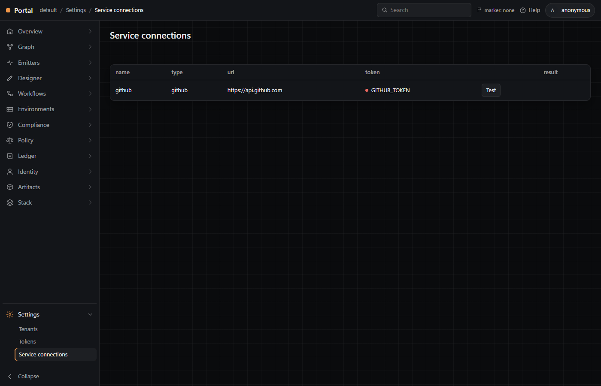

# Portal 0.4.0: shell, tenant config, auth stub, first service connection

Brief: `[WORKSPACE: Portal]`, DevOps-style shell, menu from the API, base/tenant config split, auth stub, first service connection. Edited and staged only; nothing committed. Graph.Node and GraphRenderer were read, never touched. The port is still 8200.

## Asked before building

The brief clashed with CLAUDE.md rule 1 and design 25 (the menu is graph), and with the API's shape. Jerry chose:

1. Menu: config served as a Graph.Node envelope (`GET /api/tenants/<t>/menu`), not a bare tree.
2. Paths: every route moves under `/api/tenants/{tenant}`, and the unscoped `POST /api/layers` is kept (deprecated) for Claude.Agent.
3. Writes: a token is required everywhere, the browser, the module, Smoke and Claude.Agent included.

## What landed

| Brief item | Where | State |
|---|---|---|
| 1. Config split | `portal.base.yaml`, `tenants/default/portal.yaml` (`{}`), `schema/portal.schema.json`, `internal/tenant` | Base and overlay both validated at boot; deep merge; a bad file stops the binary naming file and path. Served at `GET /api/tenants/<t>/config`. Tenant in every API path. |
| 2. Menu | `portal.base.yaml` `menu:`, `internal/tenant/menu.go` | The brief's thirteen services and their pages, Workflows' Plan / Runs (Steps) / History, Instances' four kinds. Served as an envelope of `Service` and `Page` nodes. The rail is built only from it. |
| 3. Shell | `web/index.html`, `web/portal.js`, `web/base.css`, `web/icons.js` | Banner (product, breadcrumb, search, marker, help, avatar). Accordion rail with hover flyout, collapse to icons, Settings pinned at the foot. Title, toolbar and content. `/<tenant>/<service>/<page>[/<id>]` survives a refresh. Dark grid theme. |
| 4. Pages | `web/nodes.js`, `web/screen.js` | Every leaf calls `GET /api/tenants/<t>/nodes?kind=` and draws a table or an empty state. Graph/Explore mounts the Canvas. Designer/Sections and Export mount the Designer. |
| 5. Auth stub | `internal/server/tenant.go`, `internal/tenant/auth.go`, `New-PortalToken` | Hashed `tokens.yaml` (gitignored, example committed). No token reads only and shows avatar `anonymous`; a good token writes and shows its name; a bad token is 401. `GET .../auth/whoami`. |
| 6. Service connections | `internal/tenant/connections.go`, `web/connections.js` | `connections.yaml` (gitignored, example committed). The list carries no secrets. GitHub repos come back as `git.repository` envelopes. The Settings page has a Test button showing a count or the error. |
| 7. Tests | `internal/tenant/tenant_test.go`, `internal/server/tenant_test.go`, `tests/Portal.Tests.ps1`, Smoke | Merge (base only, base plus overlay, bad overlay fails boot), menu shape, auth (no token, bad, good), secrets hidden, GitHub mocked (two pages, unset token, refused token). Existing tests green on the new paths. |
| 8. Report | this file, `docs/screenshots/` | Below. |

Results: `Invoke-Build` (Modules, Build, Test, Smoke, Pester) ended `Build succeeded. 6 tasks, 0 errors, 0 warnings`. Go has 46 tests across `cmd/portal`, `internal/server`, `internal/store` and `internal/tenant`. Pester passed 68 of 68 with none skipped (61 before). Smoke recorded `anonymousWrite 401`, the rail's thirteen services and a canvas fit of 0.853. Manual check-list items 1.1 to 1.11 and 3.1 to 3.5 were run, and their Expects are what printed.

## Screenshots

`/default/overview/summary`:

`/default/settings/service-connections` (the example github connection; `GITHUB_TOKEN` not set, hence the red dot):

Also `docs/screenshots/explore.png` (Graph/Explore with the filesystem Canvas). The old `portal.png` is removed.

## What was guessed

Each guess is a bullet in docs/design.md 36:

1. Menu nodes are two new Kinds, `Service` and `Page`, with a `has-page` edge and ids `ui:rail:...`; icons live in a State node (State gains `icon`), because `icon` is a refused display key elsewhere.
2. Menu items gained `kind`, `view` (`table`, `screen`, `connections`), `screen`, `sections`, `filter` and `dock`. `path` must equal the parent's path plus the item's id.
3. The page Kinds are made up and dotted by service (`portal.summary`, `workflow.run.step`, ...). Designer/Themes lists `Theme` and so shows real data. Export draws only the Designer's Approve section.
4. Workflow Plan, Runs (Steps) and History are tabs of an item page, `/default/workflows/all/<id>?tab=...`. The tabs are not yet filtered to the item.
5. Instances' kinds are filter chips over `properties.kind`.
6. Merge: maps by key, id-keyed lists item by item, anything else replaced. The schema requires nothing, and a separate check validates the merged config.
7. One tenant per process. Any other tenant is 404, and tenant files are read only at boot, so a new token needs a restart.
8. `nodes?kind=` spans the screen and every mounted layer, first id wins, nodes only.
9. Tokens: SHA-256 hex, Bearer only, 401 for an anonymous write and for an unknown token on any request. The page keeps the token in `sessionStorage`; the module reads `PORTAL_TOKEN`.
10. The marker is always `none` (whoami `marker: null`): nothing issues markers.
11. Repo ids are `ui:conn:<conn>/<owner>/<repo>`. `git:`'s registered shapes have no repository form.
12. **Fixed in this task: the repos endpoint now needs a bearer token.** It was first built as a plain read, so an anonymous viewer could press Test and spend the tenant's GitHub token. `GET .../connections/<name>/repos` now answers 401 without a token, though it is a GET; Go's `TestGitHubReposEndpoint` and the Pester test `Service connections` (no token 401, good token 200 against a fake GitHub) pin it. On the page, Test without signing in shows `unauthorized`.
13. The top bar's screen menu (design 25) and layer stats are gone. The stats moved to the toolbar of screen pages. Screen menu entries still exist and the Designer still adds them, but nothing draws them.
14. The dark theme follows the brief's words: 8088 was not running, so I never saw portal-temp.
15. Canvas fit: a page-wide panel fits by height, so Smoke's fit check now passes on either dimension (`data-fit-height`).
16. The help link points at the repo README on GitHub.

## Not done, and open

- Claude.Agent's Up now gets 401 from the kept `POST /api/layers` until it sends a token, since every write needs one. That change belongs to Claude.Agent.
- No page but Explore, the Designer pages, Themes and Service connections shows data. Nothing emits the page Kinds.
- `Invoke-Build Up` serves `tenants/default`, which has no `tokens.yaml` in a fresh checkout. Run `New-PortalToken -Name <you>` once, then restart.
- Manual items 2.2 to 2.5 are interactive and were not run as written. The same paths were driven in Chrome against a live portal: sign-in, Test, Designer Sections and Export, item tabs, chips, collapse. Browser screenshots timed out in that session, so the visuals come from headless Chrome.
- Proposed CLAUDE.md edits (Jerry's file):
  - The layout block gains `internal/tenant/`, `portal.base.yaml`, `schema/` and `tenants/`.
  - "a new panel type is a Category node" stays true. The rail is the tenant's menu envelope, not screen nodes.
  - The lift line still says v0.2.1; the pin has been v0.2.3 since 0.3.6.
